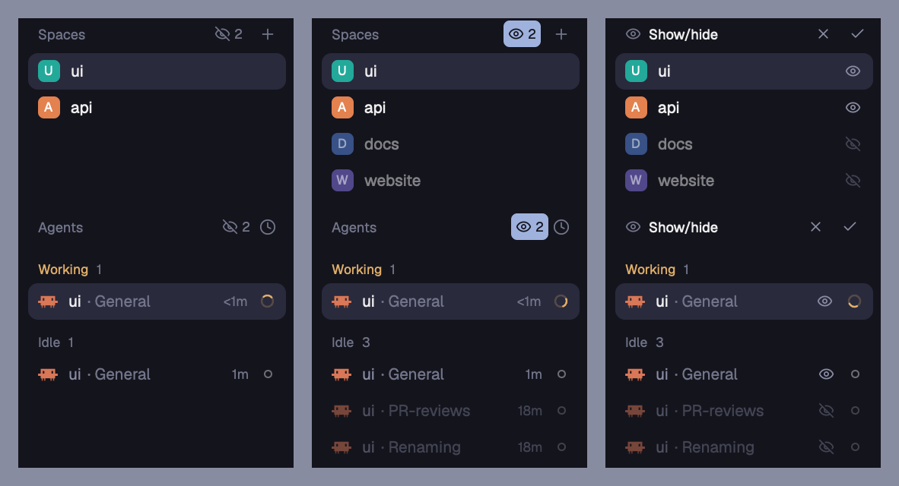

# Sidebar show/hide for Herdr

Hide the spaces and agents you do not want to see in Herdr's sidebar. Each
list gets an eye in its header. Click it, and every row gets its own eye: hide
what you do not need, then save, or discard to undo.



## What it does

- **An eye on every row** in show/hide mode, for spaces and for agents.
- **Save or discard.** Discard puts back the list as it was when you started.
- **A count in the header** shows how many rows are hidden.
- **Worktrees follow their checkout.** Hiding a main checkout hides its
  worktree spaces too.
- **Nothing gets lost.** A hidden agent that needs you shows up again until
  you answer it.
- **Survives restarts.** Agents that are closed drop off the hidden list after
  a minute.
- **Peek at hidden rows.** The `reveal` command shows every hidden space and
  agent, dimmed, without starting show/hide mode. Run it again to hide them.
  It works for both lists at once.
- **Keys:** bind them in `keys.json`, for example:

  ```json
  "global": {
    "cmd-shift-h": "show-hide-agents.reveal",
    "cmd-alt-shift-a": "show-hide-agents.visibility",
    "cmd-alt-shift-s": "show-hide-spaces.visibility"
  }
  ```

## Install

Ask the agent in Herdr to add this mod from the repo URL, or copy it yourself:

```sh
git clone https://github.com/akhilnalliboina/herdr-sidebar-show-hide
cp -R herdr-sidebar-show-hide/mods/show-hide-spaces ~/.config/herdr-app/mods/
cp -R herdr-sidebar-show-hide/mods/show-hide-agents ~/.config/herdr-app/mods/
```

Then, in a layout of your own (clone one first, Herdr's layouts are
read-only), change `"mod": "spaces"` to `"show-hide-spaces"` and
`"mod": "agents"` to `"show-hide-agents"`.

## Good to know

These mods are Herdr's own Spaces and Agents lists (version 0.1.12) with the
show/hide parts added. They do not get Herdr's later changes to those lists.
`RECIPE.md` lists every change, so you can add it again to a newer copy.

## License

The show/hide additions (`visibility.js`, `constants.js`, the eye icons and
the changes listed in `RECIPE.md`) are MIT. The rest of each `main.js` is
Herdr's own mod code, as Herdr ships it for cloning.
