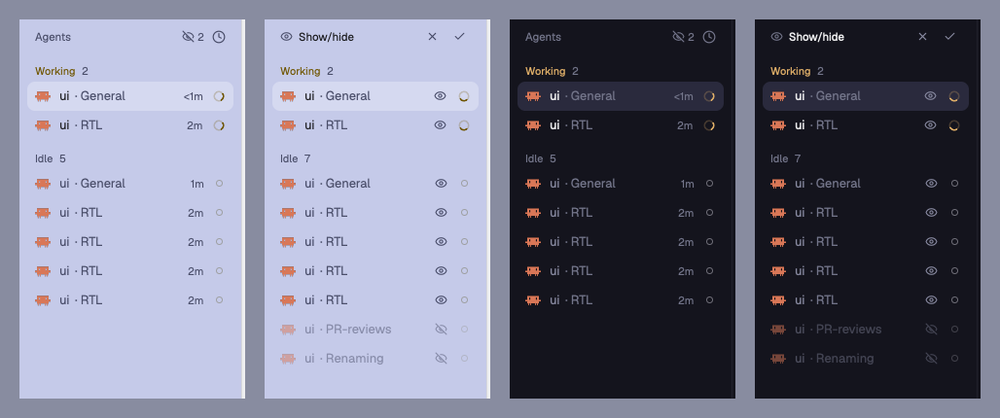

# Sidebar show/hide

Herdr's Spaces and Agents lists, each with an eye in its header. Click the eye
and every row gets its own eye: hide the spaces and agents you do not want to
see, then save or discard. Hidden rows stay out of the sidebar until you show
them again, and the header says how many are hidden.

## What you see

- **Header, normal:** the list name ("Spaces" or "Agents") on the left, then a
  13 px eye button, then the list's own buttons (Spaces: `+` for a new space;
  Agents: the sort button). When rows are hidden, the eye is crossed out and
  followed by the count, in `dim` text, 11 px.
- **Header, show/hide mode:** an eye, "Show/hide" in 11.5 px medium
  `foreground` text, then a discard button (`x`) and a save button (check),
  22 × 22 px with 5 px corners. The list's own buttons are hidden meanwhile.
- **Rows in show/hide mode:** a 13 px eye at the end of each row, in `muted`.
  A hidden row is drawn at 50% opacity with a crossed-out eye in `dim`. On
  agent rows the eye takes the place of the age and the pin button.
- **Worktree spaces** under a hidden main checkout show a faint eye that does
  nothing; its tooltip says "Hidden with the row above".
- Everything else looks and works like Herdr's own Spaces and Agents lists.

## How it behaves

- The header eye starts show/hide mode. A row's eye hides or shows that row.
  Save keeps the change; discard puts back the hidden list as it was when the
  mode started.
- Hiding a main checkout hides its worktree spaces too; showing it brings them
  back. Their own eyes are locked while the checkout is hidden.
- The space you are in stays listed even when it is hidden.
- A hidden agent with status `blocked` (it needs you) is listed again until it
  is answered. Hidden agents are left out of the agent order, so
  `agent.next` and `agent.prev` skip them.
- Hidden lists are shared values, so they survive a restart. An agent address
  or space id that has been missing for a minute is dropped from its list.
- Key commands: `show-hide-spaces.visibility` and
  `show-hide-agents.visibility` start show/hide mode, or save it when it is on.
  `show-hide-agents.reveal` (or `show-hide-spaces.reveal`) shows the hidden
  rows of both lists, dimmed, and hides them again on the next press. While
  they show, the header eye has a `hover` background and `foreground` color.

## Built from

- Each mod is Herdr's own mod (`spaces`, `agents`, version 0.1.12) copied with
  `mod.clone`, plus `visibility.js`, `constants.js`, `eye.svg` and
  `eye-off.svg`.
- `visibility.js` holds a `Visibility` class: `hidden()`, `start()`, `save()`,
  `discard()`, `toggle(id, cascade)`, `prune(alive)`, `rowToggle(...)`,
  `startButton(...)` and `editHeader(...)`. Both mods use the same file.
- Shared values: `show-hide.spaces.hidden` (space ids) and
  `show-hide.agents.hidden` (terminal addresses), read with `shared` and
  written with `setShared`.
- `show-hide.reveal` is one shared on/off value for both lists, so one key
  reveals both. `Visibility.showsHidden()` is true in show/hide mode or while
  revealed; the filters and the 50% opacity use it.
- Changes in the Spaces `main.js`: `grouped()` works out which worktree rows
  belong to which main checkout, then filters hidden rows unless the mode is
  on or the space is active. `row()` adds the eye and the 50% opacity.
  `render()` swaps the header.
- Changes in the Agents `main.js`: `render()` filters hidden agents (except
  blocked ones) before grouping and before `setAgentOrder`, prunes against
  `terminals()`, swaps the header, and the row shows the eye in place of the
  pin and the age. The sort popup opens `show-hide-agents`.
- Both read `nextCommand()` for the `visibility` command.
- Shipped icons used: `mods/workspace-chrome/x.svg`, `check.svg`.
- Layout: replace `"mod": "spaces"` with `"show-hide-spaces"` and
  `"mod": "agents"` with `"show-hide-agents"` in the sidebar of a layout of
  your own (Herdr's layouts are read-only, so clone one first).

## Watch out

- These are copies. They do not get Herdr's later changes to its own Spaces
  and Agents lists. To update, clone the new stock mod and add the changes
  above again.
- Icon paths name the mod folders (`mods/show-hide-agents/eye.svg`). Rename
  them with the folder.
- Prune only after an id has been missing for a while. Right after a start, or
  while a machine reconnects, `terminals()` and `spaces()` are briefly short,
  and pruning at once would clear the whole hidden list.
- Terminal addresses can come back for new terminals, so an agent that is
  closed must not stay hidden forever; the one-minute prune handles that.
- The narrow sidebar (rail) filters hidden rows but has no show/hide mode.

## Done when

- `herdr-app check` passes for both mod folders.
- Clicking the header eye shows "Show/hide" with discard and save, and an eye
  on every row.
- Hiding two agents and saving removes them from the list; the header shows a
  crossed-out eye and "2".
- Discard after changes restores the list from before the mode started.
- Hiding a main checkout hides its worktrees and locks their eyes.
- A hidden agent that turns `blocked` appears again.
- Hidden rows stay hidden after Herdr restarts.
- Running `show-hide-agents.reveal` lists the hidden agents and spaces dimmed;
  running it again hides them.
